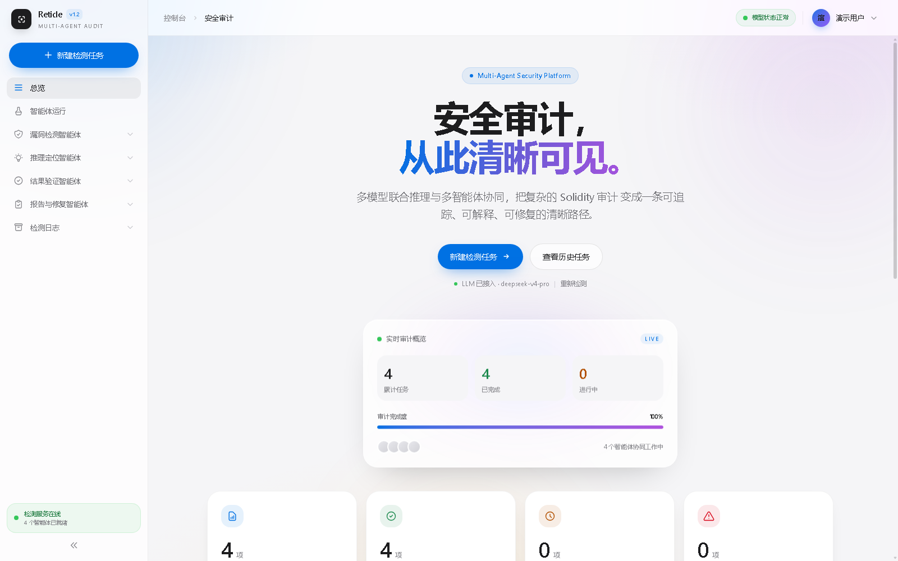
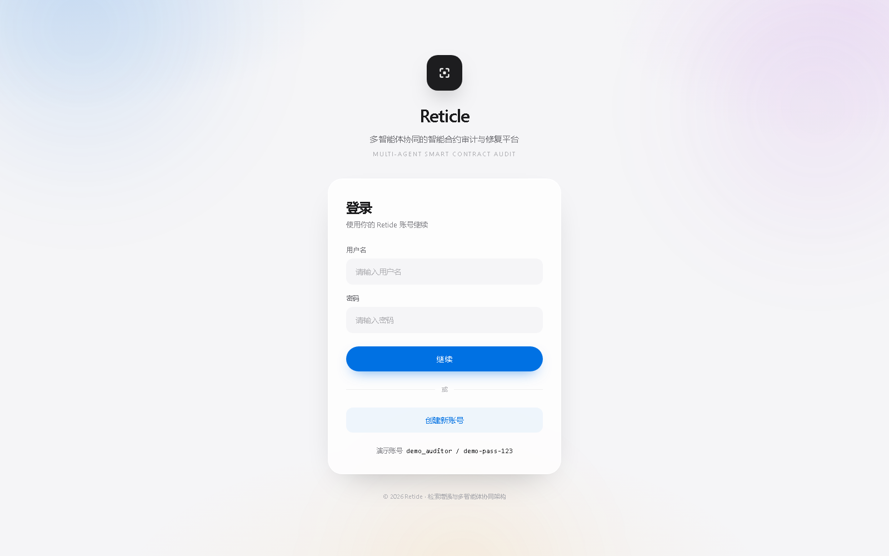
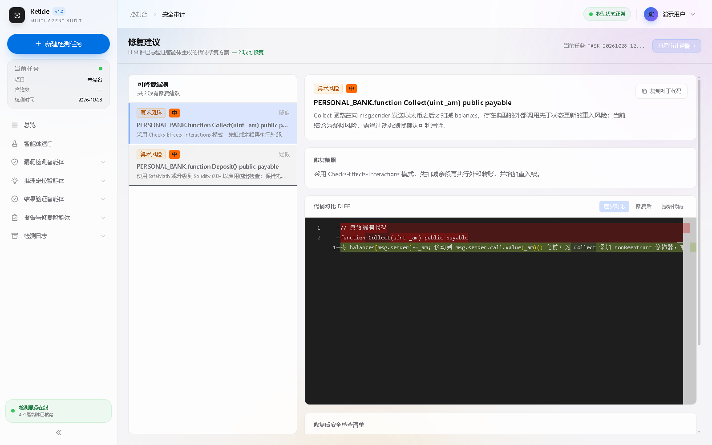

# Reticle

**多智能体协同的智能合约安全审计平台** — 多模型证据融合、函数级风险定位、可解释报告与修复建议。



## 功能

- **多模型证据融合**：LSTM 专项检测、DeepSVDD 异常检测、GCN 跨合约分析、静态规则、RAG 知识库，统一汇入证据中心
- **多智能体流水线**：检测 → 推理定位 → 验证 → 报告与修复，每个阶段可追踪
- **函数级风险评分**：`R_func` 七维加权，推理门控筛选高价值函数再交给 LLM
- **可解释审计报告**：JSON + Markdown 双产物，每条结论可回溯到函数、行号与证据
- **LLM 修复建议**：基于推理结果生成修复策略、补丁对比与复测清单
- **异步任务系统**：上传 `.sol`/`.zip`，支持进度轮询、取消、重试、历史记录
- **现代化前端**：Vue 3 + 浅色毛玻璃设计，含函数风险排名、跨合约调用图、报告页

| 登录 | 修复建议 |
|---|---|
|  |  |

## 技术栈

| 层 | 技术 |
|---|---|
| 前端 | Vue 3.5 · Vite 8 · TypeScript · Pinia · Vue Router · Tailwind CSS v4 · ECharts · Monaco |
| 后端 | FastAPI · Uvicorn · Pydantic · Python 3.10+ |
| 数据库 | PostgreSQL（兼容 Supabase），psycopg 3 |
| 模型 | TensorFlow（LSTM / DeepSVDD `.h5`）· PyTorch + ANTLR（GCN 跨合约子进程） |
| 其他 | Solidity 编译（solc/solcjs）· Slither 验证 · RAG（JSONL 知识库） |

## 目录结构

```
backend/                    FastAPI 应用与审计流水线
├─ api/                     路由、鉴权、任务管理
├─ agents/                  LLM 推理 / 验证 / 未知风险智能体
├─ model_adapters/          LSTM / DeepSVDD / GCN 适配器
├─ preprocessing/           Solidity 解析、特征提取、字节码编译
├─ function_risk/           风险评分与推理门控
├─ evidence/                证据中心
├─ rag/                     知识库检索
├─ reporting/               Markdown 报告生成
└─ run_audit.py             审计 Pipeline 主流程

frontend/                   Vue 3 + Vite 前端
├─ src/views/               10 个路由页面
├─ src/components/          布局 / 仪表盘 / 分析 / 编辑器 / 面板组件
├─ src/stores/              Pinia 状态（auth / audit）
└─ src/api/                 axios 客户端与接口封装

LG-DeepSVDD/                LSTM / DeepSVDD 模型资产
cross-contract_detection/   GCN 跨合约检测子项目
samples/                    可直接上传的测试合约
docs/                       架构图、页面说明、截图
```

## 快速开始

### 1. 依赖

- Node.js 18+
- Python 3.10+
- PostgreSQL 14+
- （可选）TensorFlow / PyTorch / Slither —— 缺失时对应模型自动降级

### 2. 前端

```bash
npm install                 # 根目录：solc 多版本编译器
cd frontend
npm ci
```

### 3. 后端

```bash
python -m venv .venv
# Windows: .venv\Scripts\activate
# macOS/Linux: source .venv/bin/activate
pip install -r requirements-backend.txt

cp .env.example .env        # Windows: copy .env.example .env
# 编辑 .env，填入数据库连接与 LLM 配置
```

创建数据库后启动：

```bash
python -m uvicorn backend.api.app:app --host 127.0.0.1 --port 8000
```

### 4. 启动前端

```bash
cd frontend
npm run dev                 # http://127.0.0.1:5173
```

API 文档：<http://127.0.0.1:8000/docs>

### Windows 一键脚本

如果本机已经配置好便携环境（`.conda/envs` + `pgdata`），可直接：

```powershell
powershell -ExecutionPolicy Bypass -File .\start-all.ps1
powershell -ExecutionPolicy Bypass -File .\stop-all.ps1
```

## 配置项

`.env` 中主要配置：

| 变量 | 说明 |
|---|---|
| `SCG_DATABASE_URL` | PostgreSQL 连接串 |
| `SCG_LLM_BASE_URL` | OpenAI 兼容接口地址 |
| `SCG_LLM_MODEL` | 模型 ID（如 `deepseek-flash`） |
| `SCG_LLM_API_KEY` | API Key（不要提交到仓库） |
| `SCG_LLM_TEMPERATURE` | 采样温度，默认 0.2 |

## 测试合约

`samples/` 内包含 7 个可直接上传的合约（重入、访问控制、整数溢出、弱随机数等），以及打包版 `all_samples.zip`。

## 说明与限制

- **模型可选**：未安装 TensorFlow / PyTorch 时，LSTM / DeepSVDD / GCN 适配器会输出静态代理证据（`adapter_mode=static_proxy_*`），主流程不中断
- **RAG 数据集未提交**：`dataset/` 约 70 MB（含知识库 JSONL），仓库默认不包含；需要时自行放入 `dataset/knowledge/`
- **GCN 推理依赖**：`antlr4-python3-runtime==4.7.2` + PyTorch，缺失时走静态代理
- **LLM 非必需**：未配置或调用失败时，推理结论为 `inconclusive`，报告仍可生成

## 文档

- [部署与运行说明](docs/DEPLOYMENT.md)
- [前端框架图](docs/frontend-architecture.html)
- [页面结构说明](docs/FRONTEND_PAGES.md)

## License

未指定许可证，默认保留所有权利。
